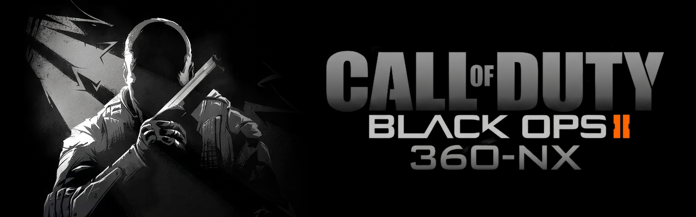

<p align="center">
  
</p>

<p align="center">
  <b>Call of Duty: Black Ops II for the Nintendo Switch and Windows, recompiled from the Xbox 360.</b><br>
  Zombies, Multiplayer and Campaign, running as native code.
</p>

<p align="center">
  
  
  <a href="LICENSE"></a>
  <a href="https://github.com/AlvaroEPena/bo2-360-nx/releases/latest"></a>
  <a href="https://discord.gg/b8qchp7WjX"></a>
</p>

<p align="center">
  <a href="https://ko-fi.com/varo"></a>
</p>

---

bo2-360-nx is a static recompilation of Black Ops II (Xbox 360, Title Update 18). The game's PowerPC code is
translated ahead of time into C++ and compiled for the Switch's ARM cores and for x86-64 PCs, so nothing is emulated
while you play, and a Vulkan renderer of its own draws the game.

> [!IMPORTANT]
> **No game data is included, and none ever will be.** You need your own Xbox 360 copy of Black Ops II and its Title
> Update 18. The release kit builds the game on your PC from your files; what it produces is yours alone and must not
> be shared.

The project was previously published as bo2-zm-nx, when it covered Zombies only.

## Contents

[Features](#features) · [Installing](#installing) · [GSC Loader](#gsc-loader) · [How it works](#how-it-works) ·
[Warnings](#warnings) · [Support](#support) · [Credits](#credits) · [License](#license) ·
[Technical documentation](#technical-documentation)

## Features

### Game modes

| Mode | What you get |
|---|---|
| **Zombies** | Every map: TranZit with Bus Depot, Diner, Farm and Town, Nuketown Zombies, Die Rise, Mob of the Dead, Buried and Origins |
| **Multiplayer** | Local matches with bots; weapon camos unlocked in Local, **Diamond** and the title update's camos included |
| **Campaign** | All 19 story missions |
| **DLC** | All Zombies and Multiplayer DLC maps, from your own DLC packs |

Switch between modes from the home menu; **Extras > DEFAULT GAMEMODE** picks the one the game opens in.

### Playing together

- **Split screen for up to four players** in Zombies and Multiplayer, each with an offline profile of their own. On the
  Switch, any Joy-Con or controller can join: a new controller in the lobby brings up the system's controller screen.
- **System Link (LAN)** between Switches and PCs.
- **Internet play with an 8-character join code.** The host picks **HOST ONLINE GAME** and shares the code; the
  others pick **JOIN WITH CODE**. The game opens the router's ports with UPnP, and when that does not work it punches
  through both routers on its own, meeting through free public relay servers that only pass addresses along. As a
  last resort the host can forward UDP ports 31000-31002 by hand.
- **Cross-play** between the Switch and Windows, on the LAN and online.
- **Zombies bots**: up to three in a Local or System Link lobby, sharing the four slots with human players. The bots
  pack (`bo2zm_bots.gscpack`) is a separate download from the [Discord](https://discord.gg/b8qchp7WjX): put it next to the game's NRO
  or executable.

### Mods and cheats

- **Built-in cheats in Zombies** (Extras): god mode, infinite ammo, explosive bullets, no recoil, max points, game
  speed, noclip and UFO, jump height, gravity, third person and field of view, zombies frozen or ignoring you, any
  round up to 255, power-ups, perks, the map's weapons with Pack-a-Punch, doors and power. Each player has their own in
  split screen, and players who join a System Link or online game keep theirs.
- **GSC Loader**: compiled Xbox 360 script mods, mod menus included, in Zombies and Multiplayer. In a Local or System Link
  game every player gets the host's menu, fitted to their own part of the screen.
  Ready-to-use Zombies and Multiplayer mod menu packs are on the [Discord](https://discord.gg/b8qchp7WjX).

### Graphics and performance

- **Presets** from LOWEST to HIGH (the Xbox 360's own settings), plus CUSTOM with nine detail options. Hold Minus and
  press Up or Down to change preset anywhere; Zombies maps can each keep a profile of their own.
- **Recommended settings:** the **VERY LOW** preset. On big maps, set **FAR OBJECTS** to **SIMPLE** if you want
  distant objects drawn; every preset hides them by default.
- **FPS cap** of 30 or 60, **VSYNC**, and an FPS counter.
- **Native code**: about 30,000 game functions compiled to ARM64 with link-time and profile-guided optimization, and
  hot game code rewritten by hand.
- **The game never changes the console's clocks.** With a safe overclock
  ([safe speeds for your model](https://rentry.co/mariko#mariko-max-safe-on-battery-hac-001-01-heg-001)), a stable
  60 FPS can be reached.
- **Optional fourth CPU core**, about 12-16 % faster at the same clocks. It needs a forwarder with four cores enabled
  (see [Installing](#installing) and [Warnings](#warnings)).

Every menu page and option: [docs/features.md](docs/features.md).

## Installing

**You need:**

- Your Xbox 360 copy of Black Ops II, as an ISO or extracted.
- **Title Update 18. Required.**
- Your DLC packs, if you have them (optional).
- A Windows PC with **Python** to prepare your files.
- For the Switch, a console that runs homebrew (custom firmware such as Atmosphère).

Nothing in the releases comes from the game: you prepare your own game files and shaders on your PC, and they stay
yours.

### Option 1: prebuilt Switch program (recommended)

The quickest way. Each release has the Switch program ready-made (`bo2-360-nx-switch-PGO-NRO.zip`, optimized with
link-time and profile-guided optimization) and the **game files and shader extractor**
(`bo2-360-nx-gamefiles-shader-extractor.zip`), which prepares the rest from your files.

1. Download both zips from the [latest release](https://github.com/AlvaroEPena/bo2-360-nx/releases/latest).
2. Unzip the extractor and drop your files (the game, Title Update 18 and any DLC) into its **Game Files** folder.
3. Double-click **Extract game files and shaders.bat**. Choose **Both** (game files and shaders) and the modes you
   want: **Zombies**, **Multiplayer**, **Campaign**. The game files take a few minutes, the shaders longer; if it
   stops, run it again and it carries on where it stopped.
4. Copy the `bo2zm` folder from the extractor's `output` folder to `sdmc:/switch/` on the SD card.
5. Copy the `bo2zm` folder from the NRO zip to the same place, merging the two (it adds `bo2zm.nro`, `bo2cp.nro`
   and their settings).
6. Start it from the Homebrew Menu opened through a game (hold R while starting one) or from a forwarder, so it gets
   the console's full memory.

The finished folder on the SD card:

```text
sdmc:/switch/bo2zm/
├── bo2zm.nro                  Zombies and Multiplayer   (NRO zip)
├── bo2zm.toml                 its settings              (NRO zip)
├── bo2cp.nro                  Campaign                  (NRO zip)
├── bo2cp.toml                 its settings              (NRO zip)
├── bo2zm_shaders.spvpack      Zombies + Multiplayer shaders, and its index (extractor)
├── bo2zm_shaders.spvidx
├── bo2cp_shaders.spvpack      Campaign shaders, and its index (extractor)
├── bo2cp_shaders.spvidx
├── game/                      your disc files            (extractor)
├── update/                    Title Update 18            (extractor)
└── user/0000000000000000/     your DLC                   (extractor)
```

### Option 2: build everything from scratch

The **build kit** builds the programs themselves on your PC as well, for the Switch, for Windows, or both. It is the
way to get the Windows version, and it needs more tools: the kit's own readme lists them and covers every option.

1. Unzip the kit and drop your files (the game, Title Update 18 and any DLC) into its **Game Files** folder.
2. Run the kit. Pick **Switch**, **Windows** or both, and the modes to build: **Zombies**, **Multiplayer**,
   **Campaign**.
3. When it finishes, its output folder holds ready-to-copy folders:
   - **Switch**: copy the `bo2zm` folder to `sdmc:/switch/` on the SD card and start it as in option 1.
   - **Windows**: start the game with the shortcut in the output folder, or make a desktop shortcut to `bo2zm.exe`.

### After installing

The first start is quick: the shader library's index comes ready-made. Each map compiles its pipelines the first
time it is played, and loads fast after that.

**Four CPU cores (optional).** The easiest way is a forwarder made with [sphaira](https://github.com/NaGaa95/sphaira): highlight bo2zm in its
homebrew list, choose **Install Forwarder** and set **CPU Cores: 4**. Start the game from the new HOME menu icon and
pick **Extras > EXPERIMENTAL > CPU CORES: 4**. The game manages which core each of its threads runs on, so it runs
well on four; as a failsafe, if the system needs the core back, it returns to three cores by itself and says so on
screen.

## GSC Loader

The GSC Loader runs compiled **Xbox 360 (T6) server scripts**, the format console mod menus ship in, in Zombies and
Multiplayer.

1. Put each mod in its own folder inside `scripts/`, next to the game: `sdmc:/switch/bo2zm/scripts/<ModName>/` on the
   Switch (beside `bo2zm.nro`), or `scripts\<ModName>\` beside `bo2zm.exe` on Windows.
2. Add a `mod.ini` that says which mode it is for and how its scripts are named. For a mod whose scripts carry their
   full game paths:

   ```ini
   mode=zombies
   names=internal
   ```

3. In the game, open **Extras > SCRIPT LOADER**, select the mod, use **CHECK SCRIPTS** to see what each file replaces,
   then **LOAD SELECTED + RESTART**.

Zombies and Multiplayer keep separate selections, and **UNLOAD ALL + RESTART** returns to the stock scripts. Source
code, PC or Plutonium bytecode and `.gscr` files have to be compiled for the Xbox 360 first. Folder layouts, every
`mod.ini` key, startup scripts and limits: [docs/script-mods.md](docs/script-mods.md).

## How it works

The Xbox 360's executable is decrypted and patched to Title Update 18, then ReXGlue's code generator turns all of its
PowerPC code into C++, which is compiled into a native Switch program (or a Windows one). A runtime built on the
ReXGlue SDK stands in for the 360's kernel and system libraries: threads, memory, files, audio, controllers and
networking. The game's own Direct3D layer still writes its commands for the Xbox 360's GPU; a native Vulkan renderer
reads them and draws each frame on the Switch's GPU through Mesa's NVK driver. The game's shaders are translated to
SPIR-V when you build, from your own disc. The details: [docs/technical.md](docs/technical.md).

## Warnings

- **Four CPU cores.** The fourth core belongs to the system, so in theory using it can make the console unstable. It
  has been tested thoroughly and does not really crash, and the game hands the core back on its own when the system
  needs it. It is your choice; I use four cores every time.
- **Sleep.** Leaving the game in sleep mode for a long time might cause problems. Close it first if you will be away
  for a while.

## Support

If you enjoy the port and want to support its development, you can buy me a coffee on
[Ko-fi](https://ko-fi.com/varo). For help, the bots pack and mod menu packs, join the [Discord](https://discord.gg/b8qchp7WjX).

<a href="https://ko-fi.com/varo"></a>

## Credits

**Ported by AlvaroEPena.** The upstream projects and libraries this port is built on, with their licenses, are listed
in [THIRD_PARTY_NOTICES.md](THIRD_PARTY_NOTICES.md). Thanks also to devkitPro and switchbrew, Atmosphère, sys-clk,
[sphaira](https://github.com/NaGaa95/sphaira), and OpenAssetTools for its documentation of the fastfile format.

## License

GPL-3.0 ([LICENSE](LICENSE)); bundled upstream code keeps its own notices, listed in
[THIRD_PARTY_NOTICES.md](THIRD_PARTY_NOTICES.md).

Call of Duty and Call of Duty: Black Ops II are trademarks of Activision Publishing, Inc. Nintendo Switch is a
trademark of Nintendo. Xbox 360 is a trademark of Microsoft. This project is not affiliated with or endorsed by any of
them, and it contains no game data.

## Technical documentation

How the port works, every optimization and what it gained, and building from source:
**[docs/technical.md](docs/technical.md)**.
